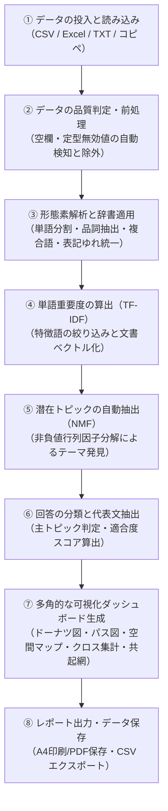

# 分析処理プロセス解説ドキュメント (Analysis Workflow & Architecture)

本ドキュメントでは、**「テキスト・自由記述 潜在トピック探索ツール (Survey Factor Analyzer)」** が、入力されたアンケートやテキストデータをどのようなステップで分析・処理し、最終的な可視化グラフやレポートへと導いているかを、データの投入順に沿ってわかりやすく整理・解説します。

---

## 📌 分析全体の流れ（パイプライン概要）

---

## 1. データの投入と読み込み（Input & Parsing）

利用者が用意したデータをブラウザ上で安全に読み込み、分析可能なデータ構造へと変換します。外部サーバーへの通信は一切発生しません。

### 対応する入力形式
* **CSV / TSV ファイル**: 一般的なカンマ区切り・タブ区切りテキスト。
* **Excel ファイル（`.xlsx`, `.xls`）**: 複数シートがある場合はデータ行数が最も多いシートを自動判別して読み込み。
* **1行1回答のテキスト（`.txt`）**: 見出しや区切り文字のない改行のみの文章データにも対応。
* **クリップボードからの貼り付け**: Excel等からコピーした表や文章をそのままペースト可能。

### 文字コードと列の自動認識
* **文字コードの自動判定**: UTF-8（BOM付き含む）と Shift_JIS（日本語Windows標準）を自動判別して文字化けを防止。
* **自由記述列の自動推測**:
  - 各列の平均文字数や、「意見」「自由記述」「感想」「要望」「コメント」「feedback」などのヘッダー名をスコアリングし、最も自由記述である可能性が高い列を初期選択。
* **属性列の自動推測と複数選択（最大5つまで）**:
  - ユニークな値が 2〜15 種類程度（例：「年代」「性別」「利用店舗」「満足度」など）の列を属性候補として自動検出。
  - チップ（バッジ）をクリックするだけで最大5つまで比較対象の属性を指定可能（自動推測されたおすすめ列には★が表示され、初期選択されます）。

---

## 2. データの品質判定・クリーニング（Quality Check & Cleaning）

分析のノイズとなる「中身のない回答」や「無意味な文字」を自動的に検知・分類し、有効なデータのみを抽出します。

### 自動判定されるステータス
1. **正常（Valid）**: 意味のあるテキストが含まれる回答（分析対象）。
2. **空欄（Empty）**: 未入力、または空白文字・スペースのみの行。
3. **定型無効回答（Junk）**:
   - 日本語定型句：「なし」「特になし」「特にありません」「ない」「無回答」「該当なし」「同上」など。
   - 英語欠損値：「N/A」「none」「null」「undefined」など。
   - 記号・ハイフンのみ：「---」「***」「・・・」「――」など。
   - 数値コードのみ：「999」「0」「-1」などの未記入コード。
   - 極短文：1文字のみ（句読点除く）の回答。
4. **有効語なし（No Valid Tokens）**:
   - 形態素解析後、分析対象となる品詞（名詞・動詞等）の有効単語が1語も抽出できなかった挨拶文など。

### 即時確認と編集
* **インライン編集**: プレビュー画面のセルを直接クリックして誤字脱字を修正したり、不要な行をゴミ箱アイコン（🗑️）で削除可能。
* **除外データ一覧（モーダル確認）**: 除外されたデータだけを一覧表示し、除外理由（定型無効、空欄など）の確認やCSVダウンロードが可能。

---

## 3. 日本語の形態素解析と辞書適用（Morphological Analysis & Dictionary）

文章を単語単位に分解し、文脈に応じた表記統一やノイズ除去を行います。

### 形態素解析エンジン（Kuromoji.js）
辞書データをブラウザ内に読み込み、高度な日本語形態素解析を実行します。

### 抽出品詞の柔軟な選択
初期設定では文章の意味を決定づける **「名詞」「動詞（自立語）」「形容詞（自立語）」** を抽出対象とします。用途に応じて「副詞」「感動詞」を追加することも可能です。

### 3つのカスタム辞書ルール
1. **表記ゆれの統一（同義語置換）**:
   - 「スマホ → スマートフォン」「UI → 操作性」「クレーム → 苦情」など、同じ意味の言葉を統一して意見の分散を防ぎます。
2. **複合語の強制結合（最長一致）**:
   - 「生成AI」「アフターサポート」「カスタマーサポート」など、分解されると意味が薄れるフレーズを1語として最優先で抽出します。
3. **ストップワード（除外語）フィルタ**:
   - **標準ストップワード**: 日本語の頻出語（「こと」「もの」「ため」「思う」「ある」「利用」など360語以上）を自動除外。
   - **カスタム除外語**: 業務特有のノイズ単語（自社名やアンケート共通語など）を自由に追加可能。分析結果のキーワード横にある「✕」ボタンからワンクリックで除外＆即時再分析も行えます。

---

## 4. 単語重要度の算出と文書ベクトル化（TF-IDF）

抽出された単語群から、各文章の特徴を浮き彫りにするための数値化（ベクトル化）を行います。

### 語彙の厳選
* **低頻度・高頻度の足切り**:
  - データ全体で1〜2回しか出ない極端に稀な単語や、85%以上の全文章に出現する一般的すぎる単語をフィルタリング。
  - ※ ユーザーが明示的に登録した複合語・強制抽出ワードは足切りを免除して確実に保護されます。
* **上位語彙の抽出**: 単語のスコア順に上位最大70語を特徴語（ボキャブラリ）として採用。

### TF-IDF スコアの計算
$$TF\text{-}IDF = (1 + \ln(TF)) \times \left(\ln\left(\frac{N}{DF + 1}\right) + 1\right)$$
* **TF（Term Frequency）**: その文章内でその単語が何回出現したか。
* **IDF（Inverse Document Frequency）**: その単語が全体のどれくらい珍しい単語か（多くの文章に出る単語ほど重みが下がる）。
* **L2正規化（長さの補正）**:
  - 文章の長短による影響（長文ほど単語が多くなりスコアが高くなる現象）を抑えるため、各回答のベクトル長が 1 になるよう正規化します。

---

## 5. 潜在トピックの自動抽出（NMF: 非負値行列因子分解）

本ツールの核となる機械学習アルゴリズムです。「文書-単語行列」を数学的に分解し、背後にある潜在的な共通テーマ（トピック）を発見します。

### なぜ NMF を採用しているのか？
従来の因子分析（Factor Analysis）では「負の負荷量（マイナスの数値）」が発生し、「この単語の寄与度がマイナスとはどういう意味か？」という解釈の難しさがありました。
**NMF（Non-negative Matrix Factorization）** は、すべての値を **0以上の正の値** で制約して分解するため、**「テーマの構成比」「単語の関連度」がすべて 0%〜100% の直感的な数値** として綺麗に説明できます。

### 行列分解の仕組み
$$V \,(N \times M) \approx W \,(N \times K) \times H \,(K \times M)$$
* **入力 $V$**: $N$ 件の回答 $\times$ $M$ 個の単語の TF-IDF 行列。
* **出力 $W$（回答 $\times$ トピック）**: 各回答がどのトピックにどれくらい関係しているか（トピック得点）。
* **出力 $H$（トピック $\times$ 単語）**: 各トピックがどの単語によって構成されているか（単語の関連度）。
* **乗法更新アルゴリズム（Lee & Seung）**: 擬似乱数シードを用いて反復計算し、高い再現性で最適解を導きます。

### トピックの自動整列とラベリング
1. **自動命名**: 各トピックで最も関連度の高い上位3単語を組み合わせて「【単語1・単語2・単語3】」という仮のテーマ名を自動生成（画面上で自由にリネーム可能）。
2. **全体シェア順の並び替え**: データ全体での割合（回答数）が大きい順にトピック1、トピック2…と自動で再採番。
3. **シェア率の端数調整**: 最大剰余法（Hare-Niemeyer法）により、合計が厳密に 100% になるよう配分。

---

## 6. 各回答のテーマ判定と代表文の抽出（Classification）

各回答がどの潜在トピックに属しているかを判定し、トピックの特徴を物語る代表的なテキストを抽出します。

1. **主トピックの決定**:
   - 各回答の $W$ 行列（トピック得点）の中で、最も高い得点を持つトピックをその回答の「主トピック」として判定。
   - トピック得点の合計に対する比率から「確信度（0%〜100%）」を算出。
2. **代表文章（文章例）の選定**:
   - そのトピックへの確信度が高く、かつ文章の熱量が伝わる **8文字以上の具体的な回答** を優先的に選定。
   - 各トピックにつき代表的な文章例を上位最大6件ピックアップしてカードに表示。

---

## 7. 多角的な可視化ダッシュボードの生成（Visualization）

得られた分析結果を、専門用語を使わずに直感的なグラフ・図表として描画します（Plotly.js を使用）。

| 図表 | 名称 | 内容・インサイト |
| :--- | :--- | :--- |
| **表1** | **基本統計・特性プロファイル** | 平均文字数・最長文字数（回答の熱量）、検出語彙数、最頻出単語TOP5。 |
| **図1** | **潜在トピックの全体構成比** | 全体の中でどのテーマが多いかを一目で把握するドーナツチャート。 |
| **図2** | **パス図（構造図）** | 潜在トピック（楕円）から重要単語（四角）への矢印と太さで関連度を可視化。 |
| **図3** | **トピック空間ポジショニングマップ** | 任意の2つのトピックを縦軸・横軸に設定した散布図。回答者の分布傾向や単語同士の近さを可視化。属性で絞り込むと該当データ以外が背景ゴースト（薄い影）になり、違いが際立ちます。 |
| **図4** | **属性別トピック傾向（クロス集計）** | 指定した複数属性（年代、満足度、地域等）ごとにトピック構成比（100%積み上げ横棒）を表示。上部タブで属性を瞬時に切り替えられるほか、「👥 全属性を並べて比較」ボタンで指定した全属性を一斉並列比較可能。 |
| **図5** | **属性別スモールマルチプルズ** | 全属性のトピック空間マップを並列配置し、属性ごとの散らばりを一斉比較（レポート出力時に展開）。 |
| **表2** | **トピック詳細カード** | 重要キーワードの関連度バーグラフ、代表的な文章例（属性バッジ付き）。 |
| **展開図** | **ワードクラウド ＆ 共起ネットワーク** | トピック内の単語の大きさを視覚化した雲状マップと、同時出現関係を結んだネットワーク図。ネットワークでは結合強度から **コミュニティ（小グループ）を自動検出し色分け表示**。 |

---

## 8. レポート出力とデータ活用（Export & Report）

分析して得られた知見を、組織内の報告や次のアクションへ繋げるための出力機能です。

* **スマートA4レポート出力（印刷 / PDF保存）**:
  - 面倒なレイアウト調整なしで、A4縦（属性なし: 2枚、属性あり: 3枚）にピタリと収まる印刷用レイアウトを生成。
  - レポート印刷時には、各トピックの単語バーが上位12語に自動拡張され、ワードクラウドや共起ネットワーク、属性別並列マップも展開された充実の資料が完成します。
* **CSVダウンロード**:
  - 全回答データに「判定された主トピック」「各トピックへの適合確率」を付与した完全版CSV。
  - トピック別の全重要単語ランキングCSV。
  - 除外データ（問題行・無効行）のリストCSV。
* **設定の永続化・共有**:
  - カスタム辞書（除外語・複合語・表記ゆれ）はブラウザのローカルストレージに自動保存。
  - テキスト設定ファイル（`.txt`）としてエクスポート/インポートでき、チーム間でのルール共有や姉妹ツールとの共通利用が可能。
